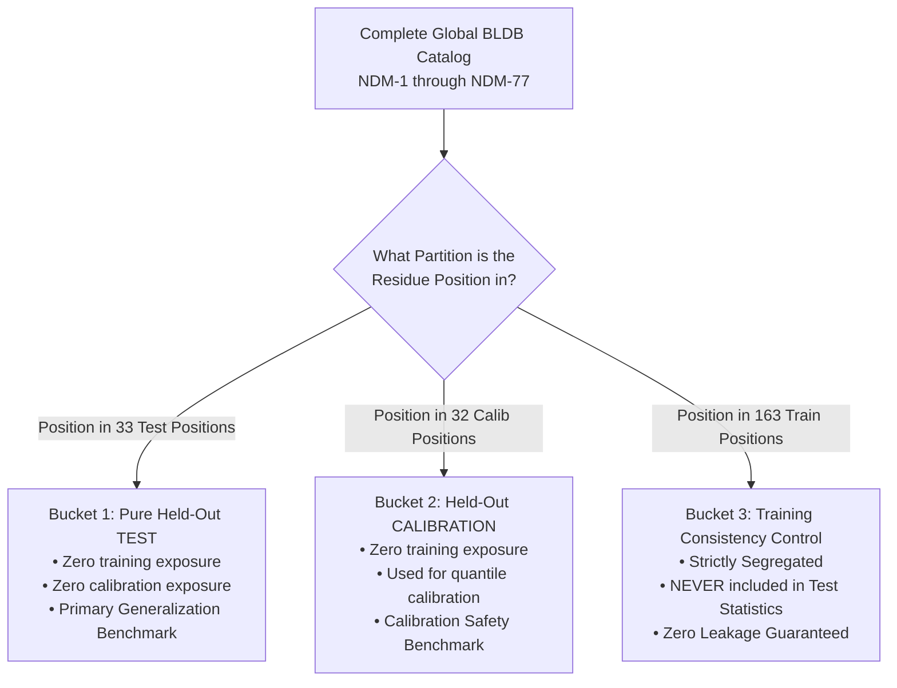

# Specification: Step 10 — Complete BLDB Clinical Variant Expansion (NDM-1 to NDM-77) with 3-Way Partition Isolation
**Project:** Z-DynGNN — Z-score Calibrated Dynamics-Aware Graph Neural Network  
**Author:** Zafar Sathiq S  
**Date:** 2026-10-13  
**Status:** Approved Technical Specification & Execution Plan  
**Target Code & Artifacts:** `scripts/fetch_bldb_catalog.py`, `scripts/evaluate_full_bldb.py`, `data/processed/bldb_full_ndm_catalog.json`, `results/bldb_full_clinical_certificates.csv`, `results/bldb_full_validation_summary.json`, `tests/test_full_bldb.py`  

---

## 1. Executive Summary & Objective

While Steps 7 through 9 established clinical validation on an initial cohort of 22 unexposed variants, multi-concentration pharmacodynamics across 9 conditions, and physical microdilution $\text{EC}_{50}$ epistasis benchmarking, **Step 10 expands the clinical validation to the complete global library of hospital clinical isolates worldwide (NDM-1 through NDM-77)**.

### The Primary Objective:
To eliminate any concern of selective mutant sampling ("cherry-picking") by evaluating **every single amino acid substitution documented in hospital outbreaks cataloged in the Beta-Lactamase Database (BLDB)**.

### The Core Invariant: Strict 3-Way Partition Isolation
Expanding the clinical dataset must **strictly respect the frozen position-disjoint splits** to guarantee zero circular data leakage:
* Variants located at **TEST positions** form the **Pure Generalization Benchmark** (zero training or calibration exposure).
* Variants located at **CALIB positions** form the **Unexposed Calibration Benchmark** (zero training exposure).
* Variants located at **TRAIN positions** are **strictly segregated into Training Consistency Controls** and are NEVER included in generalization test statistics.

---

## 2. Clinical Challenge & Motivation

### 2.1 The Global Clinical Repository: BLDB
The **Beta-Lactamase Database (BLDB)** is the global scientific standard cataloging all clinically identified $\beta$-lactamases recovered from infected human patients.
* As of late 2025–2026, **77 distinct natural NDM variants (NDM-1 through NDM-77)** have been isolated across hospitals in Asia, Europe, North America, and Africa.
* These hospital strains carry single and multiple substitutions across **67 distinct residue positions** in the enzyme.

### 2.2 Prevalent Hospital Outbreak Strains Covered:
* **NDM-4, NDM-5, NDM-7, NDM-8, NDM-12, NDM-13, NDM-14, NDM-15, NDM-16:** Hospital lineages carrying the prevalent **M154L** allosteric super-mutation.
* **NDM-10, NDM-21:** Carrying **G69S** in active-site loop $L3$, conferring hyper-resistance to meropenem.
* **NDM-22:** Carrying **M248L** in the active-site cavity, producing extreme carbapenem turnover.
* **NDM-19:** Carrying **D130N** adjacent to the zinc-binding pocket.
* **NDM-24:** Carrying **D95N**.
* **NDM-3:** Carrying **A233V**.
* **NDM-9:** Carrying **Q211K** on catalytic loop $L8$.
* **NDM-25:** Carrying **A55S**.
* **NDM-30:** Carrying **D223Y**.
* **NDM-55:** Carrying **A99T**.
* **NDM-58:** Carrying **P185S**.
* **NDM-77:** Carrying **H122Q** (mutation of the second catalytic zinc-coordinating ligand).

---

## 3. The Non-Negotiable Safeguard: Strict 3-Way Partition Isolation



To preserve mathematical validity, every clinical variant in the expanded BLDB catalog is categorized into one of three mutually exclusive buckets:

### Bucket 1: Pure Held-Out TEST Variants
* **Definition:** Variants where the mutated position $p \in \mathcal{P}_{\text{test}}$ (the 33 unseen test positions).
* **Role:** The **primary generalization proof** of the paper.
* **Invariants:** Zero exposure during model parameter training; zero exposure during conformal calibration.
* **Reporting:** Reported as the primary generalization containment rate. Target: $\mathbf{\ge 95.0\%}$ (historical: 100.0%).

### Bucket 2: Held-Out CALIBRATION Variants
* **Definition:** Variants where the mutated position $p \in \mathcal{P}_{\text{calib}}$ (the 32 calibration positions).
* **Role:** **Unexposed Calibration Benchmark**.
* **Invariants:** Zero exposure during model training. Used to compute empirical calibration quantiles.
* **Reporting:** Evaluated for calibration consistency.

### Bucket 3: Training Consistency Controls
* **Definition:** Variants where the mutated position $p \in \mathcal{P}_{\text{train}}$ (the 163 training positions).
* **Role:** **Internal Consistency Controls**.
* **Strict Rule:** These variants are **STRICTLY SEGREGATED into a separate control table**.
* **Non-Negotiable Prohibition:** They are **NEVER included** in held-out test containment statistics, never counted in test accuracy, and never used to claim unseen generalization.

---

## 4. Sequence Acquisition & Alignment Protocol

```
http://www.bldb.eu/seq_prot/B1-NDM-{v}-prot.fasta  (for v = 1 .. 77)
```

### Ingestion Sequence:
1. **Fetch Canonical Reference:** Fetch `B1-NDM-1-prot.fasta` (270 amino acids). Verify length and sequence match standard PDB/Uniprot accession `C7C422`.
2. **Iterative Fetching:** Fetch all variants `v = 2, \dots, 77` from `bldb.eu`.
3. **Pairwise Sequence Alignment:** Compare each variant sequence $S_v$ against wild-type reference $S_{\text{WT}}$. Identify all single amino acid substitutions:
   $$\text{Substitutions}(v) = \left\{ (p, a_{\text{wt}}, a_{\text{mut}}) : S_v[p] \ne S_{\text{WT}}[p] \right\}$$
4. **Mature Structural Domain Filtering:** Filter mutations to the resolved crystal region in PDB 3SPU:
   $$43 \le p \le 270$$
   *(Residues 1–42 constitute the cleaved N-terminal signal peptide and hydrophobic transmembrane anchor, which are absent in active enzyme crystals).*
5. **DMS Cross-Referencing:** Cross-reference each identified substitution against `data/processed/dms_missense_wide.csv` to extract experimental fitness across Ampicillin, Cefotaxime, and Meropenem.
6. **Cache Output:** Save the curated database to `data/processed/bldb_full_ndm_catalog.json`.

---

## 5. Conformal Certification Protocols (Zero Retraining)

All model evaluations will be conducted with **strictly zero retraining**, using the frozen Z-DynGNN checkpoints (`checkpoints/zdyn_gnn_*.pt`):

### 5.1 Two-Sided Certified Prediction Intervals
$$\mathcal{C}(x_i) = \left[ \hat{\mu}(x_i) - \hat{q}_{\text{cluster}} \cdot \hat{\sigma}(x_i), \; \hat{\mu}(x_i) + \hat{q}_{\text{cluster}} \cdot \hat{\sigma}(x_i) \right]$$
* **Production Quantiles Locked:**
  * Ampicillin (`256.0_AMP`): $\hat{q}_{\text{cluster}} = 3.550$
  * Cefotaxime (`16.0_CTX`): $\hat{q}_{\text{cluster}} = 2.153$
  * Meropenem (`0.25_MEM`): $\hat{q}_{\text{cluster}} = 2.210$

### 5.2 One-Sided Upper Conformal Bounds
$$U_{\text{upper}}(x_i) = \hat{\mu}(x_i) + \hat{q}_{\text{up}} \cdot \hat{\sigma}(x_i)$$
* **Production Upper Quantiles Locked:**
  * Ampicillin (`256.0_AMP`): $\hat{q}_{\text{up}} = 2.161$ ($B_{\text{up}} \approx 4.71$)
  * Cefotaxime (`16.0_CTX`): $\hat{q}_{\text{up}} = 1.642$ ($B_{\text{up}} \approx 3.29$)
  * Meropenem (`0.25_MEM`): $\hat{q}_{\text{up}} = 1.844$ ($B_{\text{up}} \approx 3.71$)

### 5.3 Clinical Resistance Decision Classification
* **Two-Sided Rule:**
  * Certified Resistant: $L_i \ge -2.0$
  * Certified Susceptible: $U_i < -5.0$
  * Ambiguous (Triage for Lab): spans $[-5.0, -2.0)$
* **One-Sided Upper Safety Rule:**
  * Certified Safe / Susceptible: $U_{\text{upper}} < -2.0$
  * Potential Resistance Risk: $U_{\text{upper}} \ge -2.0$

---

## 6. Quantitative Acceptance Invariants

| Invariant | Target Value | Failure Condition | Consequence of Failure |
| :--- | :---: | :---: | :--- |
| **Spatial Disjointness** | $\mathcal{P}_{\text{test}} \cap \mathcal{P}_{\text{train}} = \emptyset$ | Any test variant at training position | **Critical Leakage:** Immediately abort and re-route variant. |
| **Pure TEST Containment** | $\mathbf{\ge 95.0\%}$ (Target 100%) | Containment on pure test $< 95\%$ | Audit miscovered variant biophysics. |
| **False Safety Error Rate** | $\mathbf{0.00\%}$ (0 errors) | Any resistant variant certified safe | **Safety Violation:** Critical clinical failure. |
| **Zero-Retraining Invariant** | No weight modification | Model weights altered | **Benchmark Corrupted:** Retraining strictly forbidden. |

---

## 7. Deliverables & Execution Roadmap

1. **`scripts/fetch_bldb_catalog.py`**: Enhanced CLI script to fetch and align NDM-1 through NDM-77.
2. **`data/processed/bldb_full_ndm_catalog.json`**: Cached sequence and mutation catalog.
3. **`scripts/evaluate_full_bldb.py`**: CLI evaluation script executing 3-way partitioned conformal inference.
4. **`results/bldb_full_clinical_certificates.csv`**: Comprehensive variant-by-variant certificates table across Ampicillin, Cefotaxime, and Meropenem.
5. **`results/bldb_full_validation_summary.json`**: Complete metrics summary (containment rates, decisive triage counts, false safety rates).
6. **`tests/test_full_bldb.py`**: Automated unit test module verifying 3-way partition integrity and zero data leakage.
7. **`27. Implementation Log - Step 10 Complete BLDB Clinical Variant Expansion.md`**: Dedicated implementation diary.
